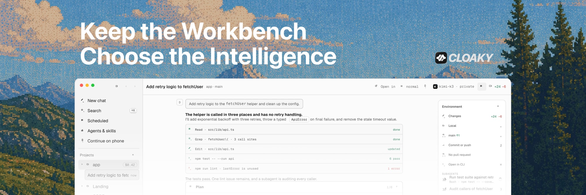

  

  <a href="https://github.com/cloakydev/cloaky/releases/latest"><b>Download</b></a>
  &nbsp;·&nbsp;
  <a href="https://cloaky.dev">cloaky.dev</a>
  &nbsp;·&nbsp;
  <a href="https://cloaky.dev/changelog">Changelog</a>
  &nbsp;·&nbsp;
  <a href="https://github.com/cloakydev/cloaky/discussions">Discussions</a>

# Cloaky Base

A desktop workbench for coding agents. It runs Claude Code, OpenCode, Codex, Kimi Code and Grok Build on [Venice](https://venice.ai) models, with your own Venice API key.

Cloaky Base is free and in beta. You can use it for daily work, and you will find bugs. Report them in [Issues](https://github.com/cloakydev/cloaky/issues), or from the app: **Settings › General › Help and legal › Report a problem**, where **Logs** shows the newest log to attach.

## What it does

- Runs five engines on one Venice key. The engines reach Venice through Cloaky, so none of them holds the key. Claude Code is optional.
- Lets you pick the model, and with it the privacy tier. The model picker lists Venice's models as Private, Encrypted and Anonymized, with each one's price and context size.
- Shows every file an agent changes in Review, and puts a turn's changes back with Undo.
- Shows each turn's tokens and cost, and stops a session at the spend limit you set.
- Starts a goal from a project. A lead model works the outcome and pauses at your budget.
- Lets you talk with the agent and hear it answer. Dictation runs on your machine with whisper.cpp. Talk-back reads replies with Venice's Private voice, and stays off until you turn it on.

## Download

[Download the latest release](https://github.com/cloakydev/cloaky/releases/latest).

| Platform | File |
| --- | --- |
| macOS 13 or later, Apple silicon | `Cloaky-<version>-arm64.dmg` |
| macOS 13 or later, Intel | `Cloaky-<version>-x64.dmg` |
| Linux x64, any distribution | `Cloaky-<version>-x86_64.AppImage` |
| Linux x64, Debian and Ubuntu | `Cloaky-<version>-amd64.deb` |
| Linux x64, Fedora and RHEL | `Cloaky-<version>-x86_64.rpm` |

The AppImage needs FUSE 2: the `libfuse2` package (`libfuse2t64` on Ubuntu 24.04 and later). Without it, start the AppImage with `--appimage-extract-and-run`.

There is no Windows build yet. The Apple silicon build has had the most testing. Reports from Intel Macs and from Linux, on Wayland or X11, help most.

Check a download before you open it

Every release has a `SHA256SUMS` file:

    shasum -a 256 -c SHA256SUMS --ignore-missing      # macOS
    sha256sum -c SHA256SUMS --ignore-missing          # Linux

The macOS builds are signed with a Developer ID certificate and notarized by Apple:

    spctl -a -vv /Applications/Cloaky.app             # expect: source=Notarized Developer ID

On Linux, the app installs an update only when the release's signing key vouches for it.

## Before your first session

- A Venice API key from an account with credit, from [venice.ai/settings/api](https://venice.ai/settings/api). Setup checks the key and the balance.
- At least one engine, installed with its vendor's own command. Setup shows which are installed and the command for the rest.

## Updates

Setup offers **Check for updates automatically**, ticked the first time. Change it, or check by hand, in **Settings › General › This Mac** (**This computer** on Linux). On Linux, updating a `.deb` or `.rpm` install asks for your password, since it installs as a system package. Your settings and sessions live in `~/.cloaky` and stay across updates.

## Privacy and safety

Cloaky sends no telemetry, analytics or crash reports. It runs no server of its own. [docs/PRIVACY.md](docs/PRIVACY.md) lists every host the app contacts and what it sends. Approvals are a review step, not a sandbox: read [SECURITY.md](SECURITY.md), which also says how to report a vulnerability privately.

## License

Free to download and use for personal and commercial work, under the [Cloaky License](LICENSE). The source is not published yet. This repository holds releases only.
